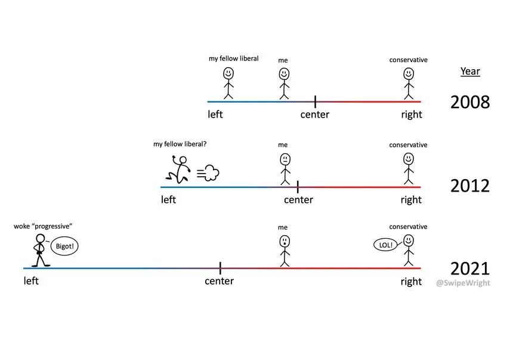

[^1]: This is a gift link!
[^2]: Infamous to the overly-online, such as yours truly.

<!-- TODO: add the replication repo link. The old link pointed to EdPol, and ideology/ has no public repo yet. -->
<!-- TODO: check the Kovacevich and Yglesias quotes against the sources; they could not be fetched. -->
<!-- *As usual, you can find the code to replicate this analysis in a GitHub repository [linked here](TODO).* -->

The perception that the Democratic Party is moving leftward, or at least is perceived by voters to be drifting leftward, is a seemingly-perennial complaint in The Discourse. Most recently, I happened upon [this tweet](https://x.com/adamkovac/status/2038384205025956071) by Adam Kovacevich that pins Democratic losses on the fact that Democrats are "well to the left of the average American;" two weeks before that Matt Yglesias penned an opinion essay in [The New York Times](https://www.nytimes.com/2026/03/16/opinion/democrats-senate-moderate.html?unlocked_article_code=1.XFA.rqm9.UaaAtPw4wLKI&smid=url-share)[^1] claiming that "the party's brand has become so toxic to overcome in so many places" and that "Another — better — idea might be for Democrats to try to change their brand." Elon Musk somewhat infamously[^2] [tweeted a comic](https://www.dropbox.com/scl/fi/rl3lnjy1sfhtlz0lpqbcb/Screenshot-2026-03-30-at-1.34.14-PM.png?rlkey=uxm02x8bl2ulnb7kvl2z0sfov&dl=0) visualizing this idea, suggesting that the Democratic Party has literally sprinted left since 2012. My cursory Google search for that tweet reveals that the phenomenon is not a partisan asymmetry: [there](https://theweek.com/cartoons/856402/political-cartoon-democrats-moving-far-left-percent-rich-scale) are [plenty](https://www.dailykos.com/stories/2018/2/20/1743099/-Democratics-and-the-Overton-Window) of [examples](https://www.reddit.com/r/WhitePeopleTwitter/comments/1p52spp/a_simple_cartoon_showing_how_democrats_became_so/) of Democrats bemoaning a similar rightward slide among the Republican Party. 

{.lightbox group="ideology-gallery" width=75%}

What these takes all presuppose, however, is that the mass public perceives the parties to be polarizing. Is this actually true? I spent some time doing my favorite procrastination activity: using data from the [Cooperative Election Study (CES)](https://dataverse.harvard.edu/dataverse/cces) fka CCES to investigate. Every year since 2009, the CES has asked respondents to place themselves, the Democratic Party, and the Republican Party on a seven-point ideological scale from "Very Liberal" to "Very Conservative."[^3] The samples are large, with 60,000 or more respondents in each presidential year since 2016. I should be clear about what this can and cannot tell us: these are perceptions, so they cannot say whether the parties themselves moved, a question better answered with [roll-call votes](https://voteview.com/). But complaints about a party's brand are complaints about perception, and that is what the CES measures.

The CES data reveals a few interesting insights. First, while it is unsurprising that the average American identifies their ideology as "middle of the road," the average American actually identifies as slightly more liberal than in the early 2010s, driven largely by a pattern of slight liberalization during Donald Trump's first term. In the same period, from 2016 to 2020, there was a larger shift in how Americans place the parties, with the Republican Party moving further right and the Democratic Party moving further left in the public's eyes. Second, Kovacevich has a point on levels: the average American does place the Democratic Party further from themselves than the Republican Party, though this is true of white Americans and not of Black, Hispanic, or Asian Americans. Third, much of the movement sits with partisans. Democrats now place themselves to the left of their own party, while the shift in how the Republican Party is seen comes mostly from people outside it.

# Americans place both parties further from the center than they did in 2016

To start, I plot where all American adults place themselves and each party in every year since 2012.

{.lightbox group="ideology-gallery" width=75%}

We can see that between 2016 and 2024, the average placement of the Republican Party moved from 5.46 to 5.82, more than a third of a point on the seven-point scale. The average placement of the Democratic Party moved from 2.48 to 2.23, about a quarter of a point. Americans' placement of themselves moved left by a little over a tenth of a point, from 4.27 to 4.15. With samples this large all three changes are statistically significant,[^4] but none of them is enormous: the Republican Party ended up just short of "Conservative" and the Democratic Party just short of "Liberal."

Two details complicate any story of steady polarization. Nearly all of this movement had happened by 2020, when the Republican Party already sat at 5.80 and the Democratic Party at 2.30. And 2016 is a generous baseline for the Republican shift, because the party had been placed at 5.67 in 2012 before falling to 5.45 in 2014. Measured from 2012, the Republican Party moved 0.16 points through 2024. The Democratic change is 0.25 points from either starting point, since the party sat at 2.48 in both 2012 and 2016.

# The average American has consistently placed the Democratic Party further away than the Republican Party

Kovacevich's claim is about distance, so I also calculate, for each respondent, how far they place each party from themselves. In 2024, Americans placed the Democratic Party an average of 1.95 points to their left and the Republican Party 1.67 points to their right. Among respondents who placed themselves and both parties, the Democratic Party was further away by 0.31 points (SE 0.036, p < .001).[^5]

This is not new. The Democratic Party has been further away in every year since 2012, although in 2019 the difference of 0.06 points is not statistically significant (SE 0.056, p = .26). The difference peaked at 0.85 points in 2014 and has ranged from 0.06 to 0.31 points since 2019, which is close to where it began in 2012 (0.35 points). What these numbers do not show is a public that has watched the Democratic Party run away from it. The average distance to the Democratic Party was 1.76 points in 2012, 1.80 in 2016, 1.85 in 2020 and 1.84 in 2025, with 2024 the high point at 1.95. The distance to the Republican Party, meanwhile, jumped from 1.21 points in 2016 to 1.67 in 2020 and has stayed there.

# Only white Americans place the Democratic Party further from themselves than the Republican Party

When breaking this out by race, the claim that Democrats are "well to the left of the average American" looks a lot like a claim about white Americans, who are roughly seven in ten CES respondents. In 2024, white Americans placed the Democratic Party 2.25 points from themselves and the Republican Party 1.56 points away. Every other group runs the opposite way: 0.71 and 2.05 points for Black Americans, 1.36 and 1.80 points for Hispanic Americans, and 1.15 and 2.25 points for Asian Americans. The same pattern holds in 2012, 2020 and 2025; in 2016, Hispanic Americans placed the two parties about equally far away.

{.lightbox group="ideology-gallery" width=75%}

The change since 2016 also splits along racial lines, though not for the Republican Party. Every group moved the Republican Party to the right by about the same amount, between 0.33 and 0.38 points. The Democratic Party is a different story: white Americans moved it left by 0.19 points and Asian Americans by 0.22 points, while Hispanic Americans moved it by 0.46 points and Black Americans by 0.62 points. Black and Hispanic Americans also moved themselves further left, by 0.30 and 0.28 points, compared with just 0.05 points for white Americans. The 0.13-point shift among Asian Americans is not statistically significant (SE 0.072, p = .067), and that smaller sample comes with considerably larger error bars.

# Democrats now place themselves to the left of their own party, while the Republican shift comes mostly from outside the party

These averages combine people with very different views of the parties, so I next split respondents into each party's identifiers and everyone else. Here, I count Independents who lean toward a party as partisans, and "everyone else" means the other party's identifiers plus the remaining Independents.

{.lightbox group="ideology-gallery" width=100%}

The largest shift in the data is in how Democrats place themselves, which moved from 3.27 in 2016 to 2.69 in 2024. Democrats also moved their party left, but by less, from 3.15 to 2.93. As a result, the average Democrat went from placing themselves 0.07 points to the right of the party in 2016 to 0.29 points to its left in 2024, with the crossover arriving by 2018. Notably, people outside the party moved the Democratic Party left by about the same amount as those inside it, from 1.88 to 1.68.

The Republican Party looks different. Non-Republicans moved the party right by 0.48 points between 2016 and 2024, from 5.57 to 6.04, about twice the 0.24-point move among Republicans. And the Republican move is mostly a recovery: Republicans placed their party at 5.52 in 2012 and 5.54 in 2024, a change that is not statistically significant (0.02 points, SE 0.020, p = .28). Non-Republicans also moved themselves left over this period, from 3.54 to 3.06. Together, those two moves increased the distance they see between themselves and the Republican Party by about a full point, from 2.13 to 3.13.

It is important to note that these are not the same people over time. The share of adults identifying as Democrats, including leaners, fell from 45.8 percent in 2016 to 41.5 percent in 2024, while the Republican share rose from 36.2 to 39.7 percent. If moderate Democrats left the party, the average Democrat would move left without anyone changing their mind, and repeated cross-sections cannot separate that kind of sorting from genuine change.[^6]

# Some of the movement among Black and Hispanic Americans reflects who answers the question

Everything above drops respondents who answer "Not sure," and those respondents have not stayed constant. The share of Black Americans who said they were not sure where to place the Democratic Party rose from 14.5 percent in 2016 to 23.4 percent in 2024, and among Hispanic Americans it rose from 15.6 to 20 percent. Among white Americans, it fell slightly, from 10.4 to 9.4 percent.

To see how much this matters, I count "Not sure" as the midpoint of the scale. This is a sensitivity check rather than a claim that these respondents are moderates. Among all adults the main results hold, at a somewhat smaller size: the Democratic Party moves 0.19 points left and the Republican Party 0.30 points right. Among Black Americans, the shift in the Democratic Party falls from 0.62 to 0.42 points and the shift in the Republican Party from 0.36 to 0.21 points. Among Hispanic Americans, those shifts fall from 0.46 to 0.33 points and from 0.38 to 0.27 points.

This also matters for any claim that voters have simply gotten better at telling the parties apart. Among Black Americans who placed both parties, the share who put the Republican Party to the right of the Democratic Party rose from 66.3 to 79.5 percent between 2016 and 2024. But count those who said "Not sure" as not placing the parties in order, and the increase shrinks from 13.2 percentage points to 3.3 (SE 1.5, p = .027), from 52.6 to 55.9 percent. For Hispanic Americans, the same exercise shrinks an 11.7-point gain to 5.7 points (SE 1.9, p = .003).

# Conclusion

Have perceptions of the parties' ideological placement shifted over time? Yes, though less dramatically than the cartoons suggest and with a timeline that depends on where you start. Americans placed both parties further from the center in 2024 than in 2016, with most of that change arriving during Donald Trump's first term and little since. The public does see the Democratic Party as further from itself than the Republican Party, as Kovacevich argues, but that has been true since at least 2012, the distance has moved little, and it describes white Americans rather than Americans of every race.

What strikes me most is how much of this happens among partisans. Democrats have moved to the left of their own party, and people outside the Republican Party see much more distance between themselves and the GOP than they did in 2016. Neither finding fits neatly with a story in which the parties ran off while voters stood still, since in both cases voters moved too.

There is plenty this analysis cannot do. Perceptions cannot tell us whether the parties themselves moved. Repeated cross-sections cannot separate people changing their minds from people changing their parties, and the CES panel I have access to begins in 2020, after most of the movement had happened. The standard errors below also capture only sampling error, and the year-to-year bounce in the off-year surveys suggests that real uncertainty is larger. A panel running through 2016 to 2020 would go a long way toward answering the sorting question, and I would love to hear from anyone who takes this up.

**Estimates.** Weighted means from CES Common Content, with Common Content weights. Standard errors of changes treat the two survey years as independent. Scale runs from 1 (Very Liberal) to 7 (Very Conservative); distances are among respondents who placed themselves and the party. Identifiers include leaners.

| Group                  | Measure                 | 2016 | 2024 | Change | SE    | p       |
|------------------------|-------------------------|------|------|--------|-------|---------|
| All adults             | Self-placement          | 4.27 | 4.15 | -0.12  | 0.016 | < .001  |
| All adults             | Democratic Party        | 2.48 | 2.23 | -0.25  | 0.015 | < .001  |
| All adults             | Republican Party        | 5.46 | 5.82 | +0.36  | 0.015 | < .001  |
| All adults             | Distance to Democrats   | 1.80 | 1.95 | +0.15  | 0.025 | < .001  |
| All adults             | Distance to Republicans | 1.21 | 1.67 | +0.46  | 0.025 | < .001  |
| Democrats              | Self-placement          | 3.27 | 2.69 | -0.57  | 0.020 | < .001  |
| Democrats              | Democratic Party        | 3.15 | 2.93 | -0.22  | 0.021 | < .001  |
| Non-Democrats          | Democratic Party        | 1.88 | 1.68 | -0.20  | 0.019 | < .001  |
| Republicans            | Republican Party        | 5.31 | 5.54 | +0.24  | 0.020 | < .001  |
| Non-Republicans        | Republican Party        | 5.57 | 6.04 | +0.48  | 0.022 | < .001  |
| Non-Republicans        | Distance to Republicans | 2.13 | 3.13 | +0.99  | 0.034 | < .001  |

[^3]: The 2008 survey asked this question on a 0 to 100 slider, so I leave it out here. Most of my plots start in 2012 for legibility, though the plot of partisans below starts in 2009. That 2009 survey did not offer a "Not sure" option.
[^4]: See the table at the end of this post for each estimate with its standard error and p-value. Off-year surveys are smaller and bounce around more than their standard errors would suggest: the Democratic Party jumped back to 2.48 in 2023 before falling to 2.23 in 2024. So I compare presidential years and try not to lean on any single one.
[^5]: This number will not exactly match the difference between the two distances, since each distance includes everyone who placed themselves and that one party.
[^6]: The [CES 2020-2022-2024 panel](https://dataverse.harvard.edu/dataverse/cces) does follow the same 6,175 respondents, and it shows little average change from 2020 to 2024: 0.03 points for self-placement (SE 0.02, p = .14), 0.02 for the Democratic Party (SE 0.03, p = .42) and -0.07 for the Republican Party (SE 0.03, p = .03). That fits the flat cross-sectional trend after 2020, but it starts too late to catch the earlier movement. One wrinkle is that people who were Republicans in 2020 rated the party 0.25 points less conservative by 2024 (SE 0.04, p < .001), though some of that may be regression to the mean on a bounded scale.
