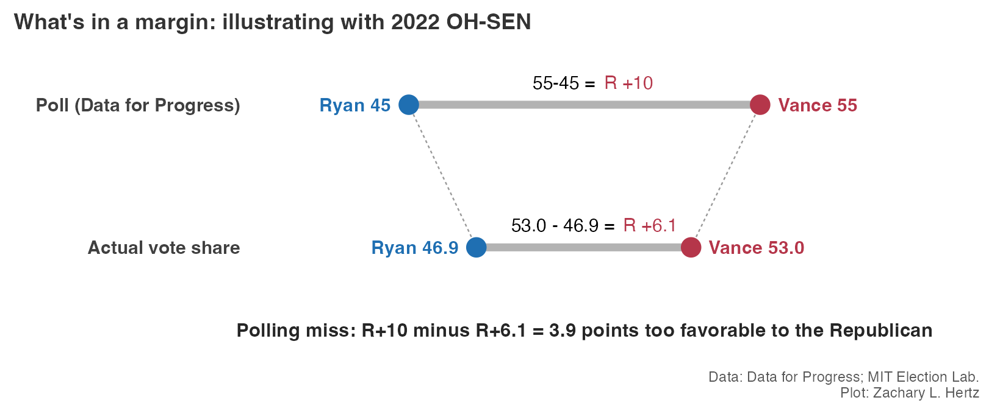
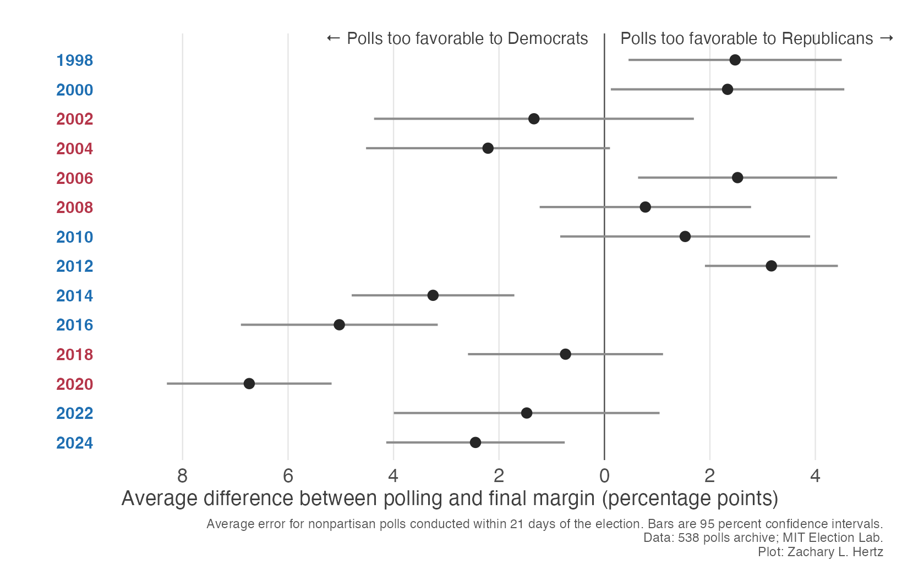
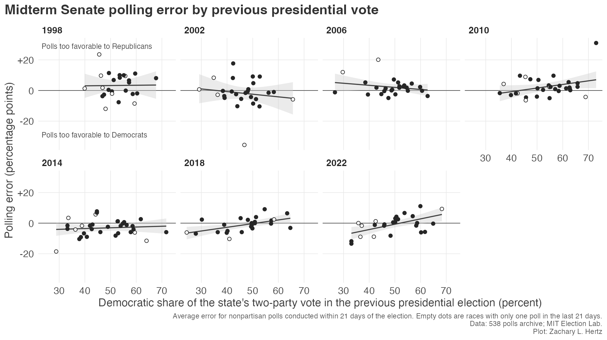
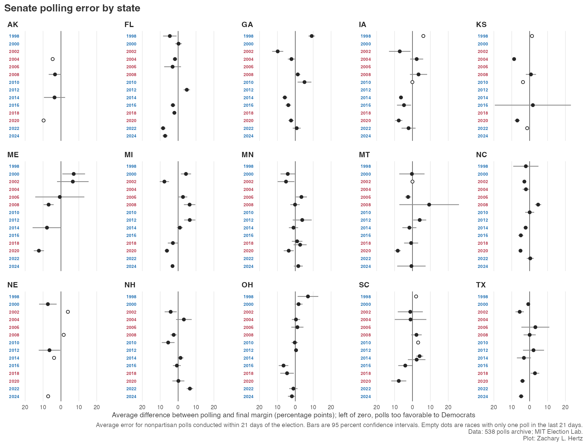
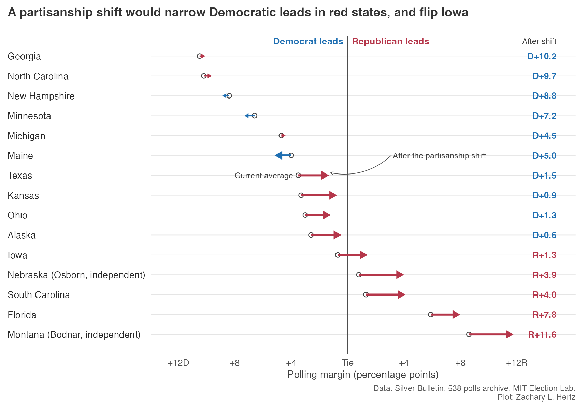

<!-- Before publishing: add a replication link? -->

I'm going to start this off with a bold prediction: **tomorrow, it will be apparent that the polls were off.**^[Bold prediction, get it?] You don't have to be a Nate to understand that what remains unclear — the question that's keeping every Democratic hobbyist poll-watcher from Kalamazoo to Kissimmee^[Or Bangor to Brownsville, or Toledo to Topeka, or Anchorage to Amarillo, or...] doomscrolling — are *"how much will the polls miss by"* and *"will they overestimate Democrats, or Republicans?"* While of course past performance is no guarantee of future results, we *can* fortunately at least set expectations to help you sleep a little easier tonight using historical polling error. In this post, I compare the average nonpartisan Senate polling in the last 21 days of the campaign with the actual results in 14 elections since 1998.

# First, a quick methods note

I grabbed polls from FiveThirtyEight's public archive.^[Rest in peace, Fivey.] The public [polling file](https://github.com/fivethirtyeight/data/tree/master/pollster-ratings) only includes polls up until 2022, so I turned to [an Internet Archive copy](https://web.archive.org/web/20241118073720/https://projects.fivethirtyeight.com/polls/data/senate_polls.csv) of FiveThirtyEight's 2024 Senate polling data. I subset down to nonpartisan polls from the final 21 days of the race. That leaves 2,404 polls across 389 races. As my source for election results, I turn to the [MIT Election Lab](https://doi.org/10.7910/DVN/PEJ5QU).

## What is a margin?

The margin between two candidates is often used as shorthand for the poll's prediction about election results. I'll leave the debate about whether this is [a good measure](https://www.patrickruffini.com/p/actually-you-should-look-at-margins) or a [fundamentally flawed one](https://x.com/RealCarlAllen/status/2115259481135141025?a=a7hkLhDQx12mN7fSn-M&s=20) to the Patrick Ruffinis and Carl Allens of the world,^[For whatever it's worth I tend to come down on the Allen side of this debate.] but it is close to an "industry standard" that most journalists use, so I focus on margin here. 

To calculate margin, you take the difference between the gap between candidates' polled vote share and the gap in their actual vote share. We'll take as an example a poll that I conducted. The [final Data for Progress poll](https://www.filesforprogress.org/datasets/2022/11/dfp_oh_final_midterm_tabs.pdf) of Ohio's 2022 Senate race had J.D. Vance beating Tim Ryan 55 percent to 45 percent, a 10-point margin. Meanwhile, when votes were counted, Vance won 53 percent to 46.9 percent, a margin of about 6 points. So, the poll predicted R+10, the election result was R+6.1, and thus the poll missed by (10-6.1=) 3.9 points, a prediction about 4 points too favorable to Republicans.

In this analysis, I calculate this for every poll, then take the average misses for each race and year. To close out this example, there were eleven polls of OH-SEN in 2022 which averaged a prediction of Vance +5.0. Because the result was Vance +6.1, this means those polls overestimated Democrats by about a point.

# Polls historically overstated both parties, but recently favor Democrats

Looking at average misses over the past 28 years, we can see that in a typical year Senate polls were about 2.6 points too favorable to one party or the other. There's a decent amount of range — in 2020, polls were nearly 7 points too favorable to Democrats — and this aggregation averages across all races polled in a given year, which means that it conceals the extent to which polls missed in *a given race*.

There does not appear to be a "midterm effect" in Senate polling misses: across seven midterm elections, the average Senate polling miss is essentially zero. Senate polling misses also do not appear to be related to partisan control of the White House. Under Democratic presidents, Senate polls overestimated Democratic Senate candidates by about a third of a point on average. Under Republican presidents, Senate polls overestimated Democratic candidates by about 1.3 points. 

One interesting that stands out, however, is that between 1998 and 2012 Senate polling tended to overestimate Republicans. In six of eight elections the polls were too favorable towards Republicans, by an average of 1.2 points. Since 2014, however, polls have overestimated Democratic candidates for Senate by an average of 3.3 points. This is driven by large polling errors in the 2016, 2020 and 2024 presidential cycles. The midterm years in that period are more muted: polls overstated Democratic Senate margins by about 0.7 points in 2018 and 1.5 points in 2022.

Some argue^[I recommend this solid [State Navigate piece](https://projects.statenavigate.com/features/total-recall-bias/).] that this year's polls are overestimating Republicans, in part because of the recent trend of pollsters weighting to recalled presidential vote. What we can see is this sort of miss might at first seem somewhat surprising, given the recent history of polls overestimating Democrats. But the data also suggests that a 2026 polling miss overestimating *Republicans* would not be surprising. Because the yearly average polling miss has a standard deviation of about 3 points across 1998-2024, and because the modern midterms overestimated Democrats by small amounts, we shouldn't be surprised if the polls favor Republicans this year. There is about a 1 in 6 chance that 2026 Senate polls favor Republicans on average by 2 points or more. An even larger miss, in which 2026 Senate polls ultimately overestimate Republican support by 5 points or more, is about 2 standard deviations out and thus unlikely but not even out of the question.

But of course, average error can only tell us so much. Given the shape of the Senate battleground, we might be more interested in whether errors are concentrated in safe or battleground states, or whether there is a correlation between a state's partisan lean and the polling error. This is especially important given that the Democratic path to a Senate majority relies on polling holding for red states like Alaska, Texas, Kansas, Nebraska and Iowa.

# In recent midterms, polls underestimate state partisanship

Here, I take midterm years and plot races' polling error against how the state voted in the previous presidential election^[I use two-party vote share for the presidential election votes, polls, and Senate results in this chart because undecided voters make safe-state polling look worse than it actually is]. A flat line means that there is no relationship between how Democratic or Republican a state is and its eventual polling error. An upward-sloping line means that polls overestimated Republicans in blue states and overestimated Democrats in Republican states; in other words, that the election results ended up more partisan than the polls suggested.

We can see that from 1998 to 2014, there is essentially no relationship between a state's presidential vote and polling misses, bar 2010 which is driven entirely by a large miss off two polls in Hawaii. In 2018 and 2022, however, we see that polls overestimated Democrats in red states and overestimated Republicans in blue states. Specifically, an increase in 10 points of a state's Republican share of the two-party presidential vote is associated with polls overestimating Democrats by about 2.4 points *more* in 2018 and 3.5 points in 2022. 

Given a Senate map where Democrats are hoping to pick up seats in recent red states like Alaska, Ohio, North Carolina, Texas, Kansas and Iowa, this dynamic is incredibly important. In 2018 and 2022, we can see that states where the party won less than 47 percent of the two-party presidential vote had polling misses overestimating Democrats by about 4 to 5 points on average. [A recent Times piece by Caroline Soler](https://www.nytimes.com/2026/10/27/us/politics/midterm-polls-errors-states.html?unlocked_article_code=1.NVE.7rUx.MZtXc0A2Y9kX&smid=url-share) notes that polling error tracked partisanship in 2018 and 2022.

One caveat to these findings is that they're averages driven by many non-competitive races. This year, where control of the Senate comes down to a [handful of key races](https://www.nytimes.com/2026/11/01/us/politics/times-siena-poll-senate.html?unlocked_article_code=1.NVE.kNGI.2LATVFKCjjOi&smid=url-share) we would want to know whether this holds in the competitive races. But of the 20 midterm races in states where Democrats won less than 47 percent of the presidential vote, only seven had a polling average within 10 points, six in 2018 alone. 

In those close races^[Beware of small-sample analysis!] in red states, polls overstated support for Democrats in six of seven races. The one exception was Texas in 2018, when polls overestimated support for Ted Cruz by about 3 points. If that pattern holds, Democrats in places like Texas, Ohio, Iowa or Kansas would run behind their final polls, even in a good year for the party.

But Texas 2018 also serves as a reminder that polling misses are not particularly correlated within-state over time, another point mentioned by [Soler's article](https://www.nytimes.com/2026/10/27/us/politics/midterm-polls-errors-states.html?unlocked_article_code=1.NVE.7rUx.MZtXc0A2Y9kX&smid=url-share). Texas Senate polling in 2018 may have overestimated Republican support, but then polling misses went on to overstate Democratic support by about 4 points in 2020 and nearly 5 in 2024. So, this begs the question: what has polling error actually been in the states that matter this year?

# Which way will polls miss? State-level histories offer little information

Here, I plot polling misses over time at the state-level for 15 states with key Senate races this year. Looking at any given state, we can see that error is noisy over time: reading down the graph we see error bounce left and right over time. Across states, polling error in one election predicts the direction of polling error in the next only 53 percent of the time.

Instead, the type of year and national environment seem far more predictive of polling miss directions. In presidential years, polls in these states have overestimated Democrats in 24 of 27 races. In the last two midterms, however, polls in these states overestimated Democrats in only 8 of 14 races. This is in part because of the previous dynamic, where polls overestimated Democrats in 8 of the 10 races in states Democrats had lost in the previous presidential election, and overestimated Republicans in all four races in states Democrats had won.

# What if the partisan pattern holds?

What would this look like in practice? I start with the state-level [Silver Bulletin polling averages](https://www.natesilver.net/p/nate-silver-2026-midterm-election-polls-model) and shift each one by the average relationship between a state's presidential vote and its polling miss in 2018 and 2022.^[The shift is 0.29 points (robust SE 0.07, p < .001, 50 races) per point of a state's 2024 two-party presidential vote above or below 50 percent, from 2018 and 2022 with year fixed effects. In a backtest using only earlier elections, a shift like this reduced typical error in races polled within 10 points from 5.49 to 4.87 points across 2016 to 2024.] You should read this **not as a forecast**, but as an arithmetic exercise. This is a uniform swing, agnostic to any national-level polling misses or candidate-quality differences^[And we would certainly expect voters to treat Ken Paxton and Susan Collins differently]. 

What this does show is how much exactly a repeat in polling errors correlated with state-level partisanship could cost Democrats tomorrow. Democratic leads of about 3 points in Texas, Ohio, Kansas and Alaska fall to between about half a point and 1.5 points, and Iowa flips entirely to the Republican column.

# How to read the final polls

None of what I wrote can definitively tell you which way the polls will miss on Tuesday. What I can offer are a few rules for reading the polls.

First, any leads within the margin of error are effectively tied. One interesting historical data point shores this up: since 1998, only 50 of 75 Senate races within 4 points were actually won by the candidate leading in the polls. Of the 314 races with a lead of 4 points or more, however, all of the candidates leading in the polling averages won. Notable almost-exception is Sara Gideon, who had a 3.8 point lead over Susan Collins heading into the 2020 Maine Senate election only to lose by more than 8 points. 

Second, don't assume you can sign the bias. Polling errors have been surprisingly variable, and the last two midterms only overestimated Democrats by about a point. A D+3 polling miss and an R+2 polling miss are equally likely, but each would be the miss that launched a thousand takes. 

Third, we should be especially skeptical of small Democratic leads in red states. Looking at states where Democrats won 47 percent or less of the two-party presidential vote since 2014, Democrats had leads of less than 6 points in five races but only won one: 2018 MT-SEN. In these same states, Republicans had leads of less than 6 points in 13 races and won all 13. Of course, a national polling miss underestimating Republicans could turn this on its head in 2026. But because the potential Democratic majority relies on these states (Ohio, Florida, Iowa, Alaska, Texas, Kansas, South Carolina, Montana and Nebraska) a systemic polling error in these states could limit their inroads. 

Finally, don't assume history will repeat itself. Polls in Texas went from overestimating Republicans in 2018 to overestimating Democrats in 2020 and 2024. The last cycle can only tell you so much.

If we expect the pattern of Democratic underperformance in red states to continue into 2026, it's possible Democrats in places like Texas, Ohio, Iowa or Kansas run behind their final polls, even despite a bluer national environment. But, if the polls are indeed underestimating Democrats nationally, as some have speculated, those two forces would partly cancel.
