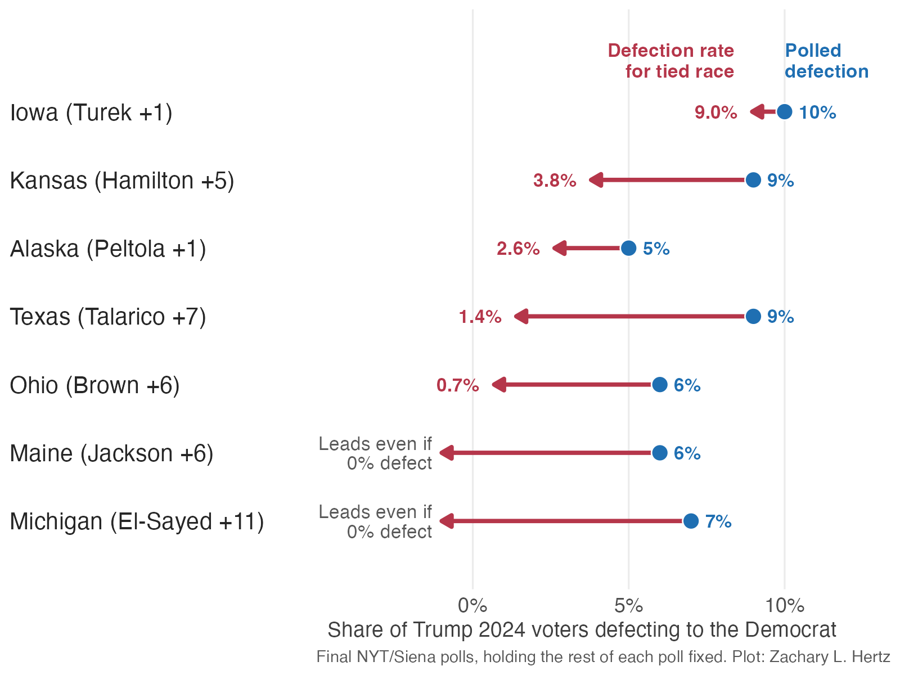
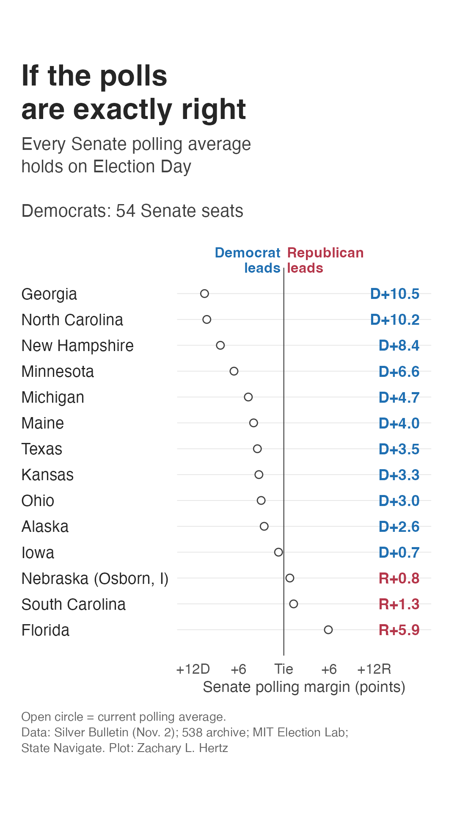
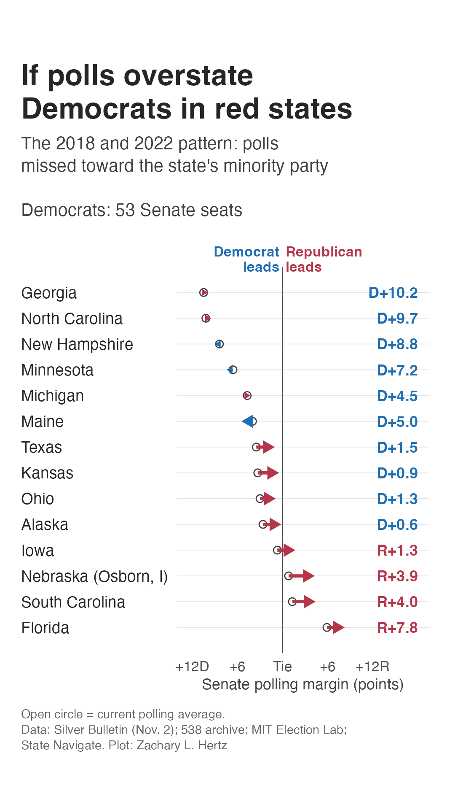
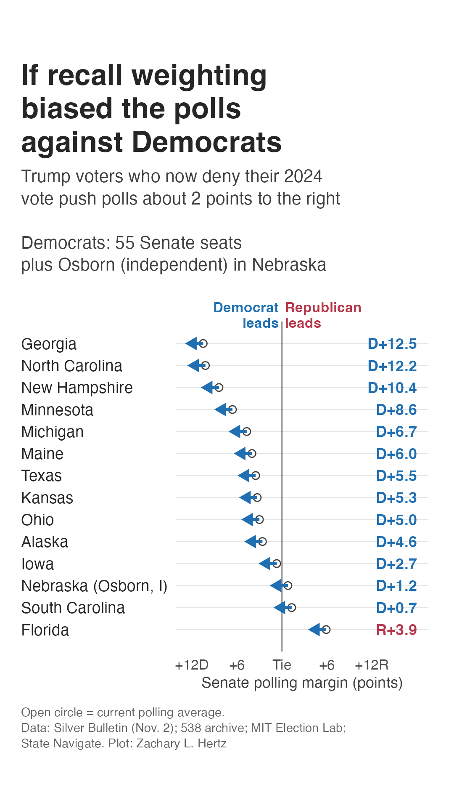

<!-- DRAFT 2026-11-03. Before publishing: add replication link? -->

Yesterday I wrote about [what Senate polling error has historically looked like](https://zacharylhertz.github.io/posts/2026-11-02-senate-polling-misses/). I got a few messages from readers who took this to mean that polls always overestimate Democrats.^[Understandable given that some of these readers only had access to the headline and subtitle on Instagram.] But, as discussed in that post, this isn't really what we should take away from the historical polling error. On average, Senate polls overestimated Republicans in most elections between 1998-2012 and have overestimated Democrats since 2014. But in the last two midterm elections these polling misses were relatively small and tended towards a specific pattern: underestimating whichever party had won the state in the last presidential election. My read of the data is that a polling miss in either direction wouldn't entirely be surprising.^[Sorry to commit the [oft-memed sin.](https://www.reddit.com/media?url=https%3A%2F%2Fpreview.redd.it%2Fodgyzctkg01c1.jpg%3Fwidth%3D1024%26auto%3Dwebp%26s%3Dfd382ef7ba184ab369ae1c40a1ce2b57070c414c)] But while hedging might be great for statisticians, it makes for poor punditry. So in this post I attempt to lay out the basic case for *why* polls might overestimate Democrats or Republicans, and what each potential world looks like.

The large part of my argument centers on my continued anxiety about a methodological choice pollsters have increasingly made this year: something called **weighting to "recalled vote."** What this means is that pollsters ask survey respondents who they voted for in the 2024 election, then attempt to use those answers to correct for possible nonresponse bias and serve as a benchmark when they make projections about the 2026 electorate. 

I'm uneasy about its use for a few reasons. First, recall weighting introduces potential polling errors that can cut in different directions. If a survey gets the right number of Trump voters responding, but the Trump voters who respond are more persuaded by Democrats than the ones who do not, the poll will overestimate Democratics once you weight on whether respondents voted for Trump. But the well-meaning correction might be off itself: if, as [many analysts have been warning us](https://www.theargumentmag.com/p/the-trump-voters-telling-pollsters), people who voted for Trump in 2024 lie about voting for him, or if pollsters miscalculate what share of 2026 voters voted for Trump in 2024, then the poll will overestimate Republicans. Finally, the widespread use of recall weighting, which already tends to reduce variance in results, increases the risk of correlated polling errors. This might work out well in this election, but does open the industry up to a future 2020-style catastrophic miss.

To try to help us understand what to expect, I consider each possibility as well as a third way Republicans could outperform the polling in a way that has nothing to do with weighting, and talk about what the rough House and Senate outcomes would be tonight under each scenario. I'll note at this point that this is **not** a forecast, but intended to be more of a sharpening of heuristics. Because I'm trying to put my money where my mouth is,^[And improve on what I would admit is a pretty poor prediction record.] I have made predictions about several election outcomes tonight on my [predictions page](https://zacharylhertz.github.io/predictions). You can draw your own conclusions about what I think will happen tonight from those^[Spoiler: somewhere in the middle!] but for now I want to lay out the best evidence for a blue tsunami, blue wave, or blue puddle, so that when the dust has settled we can have a head start on understanding what might have happened.

# Pollsters are correcting samples by asking people who they voted for in 2024. Do we trust the answers?

Most pollsters now ask respondents whom they voted for in the 2024 presidential election, then use these answers to weight the sample such that the share of their electorate who voted for Trump or Harris resembles the actual election results. In 2024, [almost 70 percent of national polls](https://www.pewresearch.org/methods/2026/09/16/weighting-polls-on-party-affiliation-and-past-vote/) used either party identification or past vote to weight their sample. 

The appeal is understandable. After the industry move towards weighting on education in 2016 and 2020, this was one of the few tools available to pollsters that could reliably reduce some of the errors underestimating Trump. Furthermore, election results are one of those rare statistics for which we have a clear, quantifiable population measure.^[I use this as an introductory teaching example about population statistics for this very reason!]

What troubles me are the known problems that exist with weighting on recalled vote. Academics know that [people tend to say they voted even when they didn't](https://www.dropbox.com/scl/fi/xbypoioz32fvwf0jcwutc/validation-what-big-data-reveal-about-survey-misreporting-and-the-real-electorate-1.pdf?rlkey=lb5m9bihjtg07vpcijrkn49o4&dl=0) and that they also [tend to misremember voting for the winner](https://www.dropbox.com/scl/fi/ozi44m8cycltyzqu7cn9d/Wright-ErrorsMeasuringVote-1993.pdf?rlkey=6ihgf6lt42pvwe9jvbq7by3cs&dl=0). This shows up among practitioners as well — Nate Cohn, explaining why the New York Times/Siena poll [had deffered on using recalled vote for weighting](https://www.nytimes.com/2026/05/18/upshot/times-siena-poll-changes.html), noted that roughly 15 percent of people who are validated voters report voting for someone other than the two major candidates, about half of people who are confirmed to have *not* voted still say that they did, and that people who voted for the most recent winner are historically more likely to say whether or not they voted. Instead, Times/Siena works around this by creating a modeled prediction about how people voted, which predicts a difference between modeled and self-reported vote for about one in five respondents.

This matters tonight because it implies history may be a weaker guide than usual.^[And, per yesterday, the last election only predicts the direction of polling error about 53 percent of the time.] Cohn [points out](https://www.nytimes.com/2026/10/19/upshot/polling-midterm-elections-senate.html) polling error already seems to have shifted in its geography: Wisconsin, ground zero for massive polling misses in 2016 and 2020, has had smaller errors recently, while recent misses emerged in Florida and New Jersey. This should not be surprising: as pollsters have adopted new techniques to try to keep up with a shifting environment, the ways in which they are wrong have changed too.

# If the polls overestimate Democrats, it's because you can't weight your way out of a bad sample

We'll start with making the case that polls might be overestimating Democrats. This starts with response rates. In the final Times/Siena national poll, [white Democrats were about 30 percent more likely than white Republicans to respond to the poll](https://www.nytimes.com/2026/10/30/upshot/times-siena-poll-midterms-questions.html?unlocked_article_code=1.NlE.JDjz.KNVlzjvlVcDq&smid=url-share). This is a larger partisan gap among this group than 2024, and similar to about 2020, when the polls underestimated Trump by about 4 points.

Using recalled vote weights can fix the apparent number of Trump voters in any given sample. But it's less able to account for *which* voters respond to the survey, and whether or not they are representative of the Trump voters who turn out in 2026. This is problematic because if Trump voters who respond to polls are also the Trump voters who are most open to voting for Democrats this year, increasing the weight on these people will make the problem of overestimating Democratic support *worse*, not better. This is something Cohn notes candidly, and he admits even the most sophisticated methodological tweaks they have fail to overcome this: when he applies the new Times/Siena weighting methods to their 2020 polls, he finds they [still would have overestimated Biden "by a wide margin."](https://www.nytimes.com/2026/06/29/upshot/times-siena-polling-changes.html)

The geography of the Senate map could make this worse too. As I [showed yesterday](https://zacharylhertz.github.io/posts/2026-11-02-senate-polling-misses/), 2018 and 2022 midterm polling overestimated Democrats running in red states and Republicans running in blue ones, by about 0.29 points in margin per point in the state's presidential vote. We might have reason for concern, given 2018, where polls were accurate on average and still underestimated Republicans in Indiana, Missouri and Tennessee. Perhaps this is the canary in the coal mine for a Democratic Senate majority that must cut through Texas, Ohio, Alaska, Iowa and Kansas.

## Late consolidation could make it seem like polls underestimated Republicans even if they were actually right

Republicans could beat the polls, even if they're right! Looking at the five red state Senate Times/Siena polls, voters who went for Trump in 2024 were [more than twice as likely](https://www.nytimes.com/2026/10/30/upshot/times-siena-poll-midterms-questions.html?unlocked_article_code=1.NlE.JDjz.KNVlzjvlVcDq&smid=url-share) as Harris voters to be undecided in their 2026 vote choice, and about 9 percent of these Trump 2024 voters were backing Democratic candidates in 2026, even as fewer than 3 percent of Harris 2024 voters were backing Republican candidates. Writing in October, Cohn notes that this is his *single biggest fear* - if this amount of persuasion is overstated, or changes before election day, polls that are perfectly accurate would still overestimate election-day Republican support.

I made the classic blunder and went diving into the Times/Siena crosstabs. This pattern, in which voters who are undecided in the Senate race are disproportionately Trump 2024 voters, continues in the battleground polls released this weekend. In Ohio, 68 percent of undecideds report voting for Trump and just 12 percent report voting for Harris; in Texas, undecideds report voting for Trump 54 percent to Harris 14 percent.^[These are small groups, of about 29 respondents in Alaska and 101 in Texas, so we should treat these estimates as having wide error bars.] If we assume that these undecided voters tend to break similar to their 2024 partisanship, we'd expect a decrease in Democratic margins by about 4 to 5 points in Ohio, Texas and Alaska, and by about 2 points in Iowa. 

Of course - this is far from guaranteed, and is possibly even a Republican-leaning way to read the numbers. These same undecided voters tend to be strongly disapproving of Trump — about 44 percent disapprove to 23 percent approve in Ohio and 51 percent disapprove to 20 percent approve in Texas — which somewhat circularly suggests to us the exact reason they're undecided voters.

## The best evidence against a pro-Republican miss: Trump's missing voters stay home

So, then, having made the case for how polls might underestimate Republicans, why might we expect a break in the historical trend? Trump's 2024 victory was powered by a swing towards Trump among people who are disengaged and tend not to vote, but made it to the polls for him in 2024. These voters tend not to take surveys, but also [tend not to vote in midterm elections](https://www.nytimes.com/2026/10/19/upshot/polling-midterm-elections-senate.html). We would expect the pro-Republican polling miss to be worst if people who don't respond to polls favor Republicans and also turn out to vote. This is likely part of why Trump-era polls in lower-turnout elections have been less likely to underestimate Republicans: 2018 underestimated Democrats slightly, 2022 was relatively accurate despite a similar partisan response gap, and last year's polling underestimated Democrats by a large amount in New Jersey and Virginia. Furthermore, there's evidence that conflicted voters are more conflicted than they were in 2018: Trump has [less than 41 percent approval](https://www.nytimes.com/2026/10/19/upshot/polling-midterm-elections-senate.html) in every battleground red-state race, a nearly 10 point decrease over his approval rating in similarly-red races in 2018.

# If the polls underestimate Democrats, it's because pollsters foresaw the wrong electorate

We now shift to the second case: are polls underestimating Republicans? One key trend that could be exacerbated by weighting on recall is a more modern problem. As disapproval of Donald Trump [has grown](https://fiftyplusone.news/polls/approval/president), pollsters have reported that more and more people who voted for him in 2024 no longer tell pollsters that they voted for Trump. Lakshya Jain, using a survey that asked people right after the 2024 election who they voted for and then recontacted the same people in February 2026, [finds that about 6 percent of Trump voters tell pollsters that they either voted for Harris or didn't vote at all](https://www.theargumentmag.com/p/the-trump-voters-telling-pollsters), and nearly one in four of Trump 2024 voters who now disapprove of him lie about their vote.

Why does this matter? If this type of error is widespread and pollsters use weights that depend on self-reported Trump voters, then their estimates of Trump voters overweight voters who are *more* supportive of Trump than the electorate would be. If they proceed to weight those voters such that they're the same share of the 2026 electorate as they were in 2024, the projected electorate becomes more supportive of Republicans than the actual results might reflect. State Navigate [estimates that this might overstate Republicans in the generic congressional ballot by about two points](https://projects.statenavigate.com/features/total-recall-bias/), or about one point under more conservative^[Statistically, not ideologically.] assumptions.

This is not the only potential problem facing pollsters trying to model the 2026 electorate. Pollsters have to decide what the 2026 electorate will look like. This means estimating models to guess who will actually vote. Often, this draws on public records of individual-level voting history: someone who voted in the last midterm (2022) is generally seen as more likely to vote in this one, and someone who stayed home is seen as less likely to vote.

But while *who* votes in a given year may be correlated across years, sometimes there are noticeable changes in the electorate across years. If some group that stayed home in past midterms is activated in the current midterm, likely voter models may underestimate their turnout rates and subsequent influence on the results. This has happened before: in 2018, Times/Siena [underestimated Democrats in Texas and Nevada](https://www.nytimes.com/2026/10/31/upshot/poll-nebraska-osborn-times-siena.html?unlocked_article_code=1.NlE.kTVR.HHOwM7Nv0UWB&smid=url-share), states where 2014 turnout had been unusually low leading to too few Democrats in the state being seen as likely to vote in midterm elections. 

How much have pollsters insulated themselves against similar changes in this midterm election? Noah Wyhof-Rudnick, who [tracked the recalled vote in 207 state and district polls](https://medium.com/@rudnicknoah/what-are-the-pollsters-thinking-052eab9611c8), suggests that this might be a likely point of failure, and I'm inclined to agree. If pollsters *were* modeling turnout changes, we should see differences from state to state based on where turnout has been shifting. States where turnout has been changing should see projected 2026 polls that are further from the 2024 presidential votes, and vice versa.

Instead, he finds that there is basically no relationship between how much turnout shifted between 2020 and 2024 and the electorate that pollsters are projecting. More concerningly, he also finds that by October most public polls had converged on predicting an electorate almost uniformly two to three points bluer than 2024, across states. This suggests to me that the states where pollsters have been most cautious are also states where Democrats are most likely to overperform the polls tonight.

## The best evidence against a pro-Democratic miss: the evidence for recall bias may not be representative

What's our favorite Nate have to say about this? Cohn says that while he's open to this theory, he [would not "take this theory to the bank."](https://www.nytimes.com/2026/10/30/upshot/times-siena-poll-midterms-questions.html?unlocked_article_code=1.NlE.JDjz.KNVlzjvlVcDq&smid=url-share) Why? As stated previously, the evidence that people are lying or misremembering their 2024 votes means that you have to contact the same exact people in 2024 and 2026. The types of people that pollsters are able to get to fill out a survey twice, especially after almost two years, tend to be the enthusiastic and engaged respondents who recently also tend to be most open to voting for Democrats. If the Trump voters we can recontact are also the Trump voters most likely to defect to Democrats, then we end up overstating the extent to which Trump voters are supporting Democrats in 2026.

# Both stories about a pro-Democratic and pro-Republican polling miss depend on 2024 Trump voters who now disapprove of him

By now you might be noticing that this story comes down to the same particular slice of the electorate: Trump voters who recently soured on him. In the Jain panel data, this is a not-inconsiderable number of voters — about 15 percent of Trump voters now disapprove of his performance as president, and about 6 percent of Trump voters say they didn't vote for him in 2024.

These two forces push the poll in opposite directions. If the Trump voters who disapprove of him respond to polls more than Trump voters who approve of him, then polls will potentially have a sample of Trump voters who are too supportive of Democrats, and then weighting those voters up ends up making the poll too Democratic. But, if some of those Trump voters who disapprove end up denying that they voted for him in 2024, the self-reported Trump voters appear more loyal to Republicans than they actually are, and weighting those voters up ends up making the poll too Republican. 

Essentially, **whether you think the recall weights will miss in favor of Democrats or Republicans depends on whether disapproving Trump voters are more likely to answer polls, or more likely to deny their 2024 vote once they do answer the poll.** As far as I know, we don't have much public measurement about the way these dynamics might play out.

{.lightbox group="post-gallery"}

To try to walk through what this looks like, I put forward a small toy model of one such poll with a few assumptions.^[Imagine a 2026 electorate made up entirely of 2024 voters, split 50-50 Trump-Harris. We do this to ignore turnout and focus on how recall weighting creates problems. We assume 15 percent of Trump voters disapprove of him and 30 percent of those disapprovers back Democrats, while Trump approvers back Democrats just 1 percent of the time and Harris voters back Democrats 98 percent of the time. These numbers are assumptions based on public numbers and chosen for illustration.] If we think that disapproving Trump voters are more likely to respond to polls at a rate one and a half times more often than approving Trump voters, the poll topline ends up overestimating Democrats by about 1.7 points. If we consider that about one in four of those disapproving Trump voters *also* deny who they voted for in 2024, as they did in the panel data, we see a swing of about 4.1 points towards *Republicans* in the topline. This adds up to about a net miss in the topline of about 2.4 points overestimating Republicans.

These numbers are imprecise - the point is that weighting by recall can in fact lead to the same voters causing both Democratic and Republican biases which offset rather than compound. So, instead, I created a quick input for you to set your own assumptions and see how this should affect the overall topline below. In the first, **response rate**, you set an assumption for how much more or less likely Trump voters who disapprove of Trump respond to surveys compared to those who still approve of him today. A number below 1 means you think disapprovers are less likely to respond to polls and a number above 1 means they answer more often. **Denial** sets the rate at which you think 2024 Trump disapprovers are misreporting their vote in the 2026 polls. I then apply these to the Silver Bulletin Senate polling averages, so you can see how your assumptions might affect tonight's results.

```{ojs}
//| echo: false
viewof over = Inputs.range([0.2, 3], {step: 0.1, value: 1.5, label: "Response rate (×)", width: 360})
viewof deny = Inputs.range([0, 40], {step: 1, value: 25, label: "Denial (%)", width: 360})
```

```{ojs}
//| echo: false
pollErr = (r, d) => {
  const a = 0.77, TA = 0.5 * 0.85, TD = 0.5 * 0.15, H = 0.5, m = p => 2 * p - 1;
  const truth = 100 * (TA * m(0.01) + TD * m(0.30) + H * m(0.98));
  const rTA = TA * a, rTD = TD * a * r, adm = rTD * (1 - d), den = rTD * d;
  const mT = (rTA * m(0.01) + adm * m(0.30)) / (rTA + adm);
  const mH = (H * m(0.98) + den * m(0.30)) / (H + den);
  return 100 * (0.5 * mT + 0.5 * mH) - truth;
}
err = pollErr(over, deny / 100)
races = [
  ["Georgia", 10.5], ["North Carolina", 10.2], ["New Hampshire", 8.4], ["Minnesota", 6.6], ["Michigan", 4.7],
  ["Maine", 4.0], ["Texas", 3.5], ["Kansas", 3.3], ["Ohio", 3.0], ["Alaska", 2.6], ["Iowa", 0.7],
  ["Nebraska (Osborn, I)", -0.8], ["South Carolina", -1.3], ["Florida", -5.9]
].map(([state, avg]) => ({state, avg, adj: avg - err}))
lead = v => (v >= 0 ? "D+" : "R+") + Math.abs(v).toFixed(1)
seats = 43 + races.filter(d => d.adj > 0 && !d.state.startsWith("Nebraska")).length
md`**Under your assumptions, recall-weighted polls are ${Math.abs(err).toFixed(1)} points too favorable to ${err >= 0 ? "Democrats" : "Republicans"}.** Correcting the Senate averages for that miss gives Democrats **${seats} seats**${races.find(d => d.state.startsWith("Nebraska")).adj > 0 ? ", plus Osborn leading in Nebraska" : ""}.`
```

```{ojs}
//| echo: false
Inputs.table(races.map(d => ({"State": d.state, "Polling average": lead(d.avg), "Your corrected margin": lead(d.adj), "Flips?": Math.sign(d.adj) !== Math.sign(d.avg) ? "Yes" : ""})), {rows: 14, height: 520, layout: "auto"})
```

Note that this is applied uniformly to every state when we think that there will likely be differences across states. This is meant for you to see, generally, how these assumptions shape our predictions.

## Small differences in which Trump voters answer have big impacts

Clearly getting these voters right are going to be key to tonight's results. Because Trump voters make up 40 to 48 percent of the projected electorate, every additional percentage point of Trump 2024 voters who defects to Democrats ends up swinging the margin about 0.8 to 1 percentage points towards Democrats. If we take the NYT/Siena polls as ground truth^[Big if!] we can see to what extent changing defection among Trump voters erodes the polling leads in these states.

{.lightbox group="post-gallery"}

In Iowa, Josh Turek holds a narrow one-point lead based on an estimate that 10 percent of Trump voters will back him. Just one point less of defection would lead to a tied race, holding all else equal. Kansas and Alaska, with larger leads, survive misses in persuasion by about two to five percentage points. In Maine and Michigan, the polled lead is big enough that the Democratic candidates win even if 0% of Trump voters defect. The caveat here is that if the NYT/Siena polls are bluer than the realized environment, it would take smaller misses on defection rates to flip the races.

# What does this mean for House and Senate control?

As a blunt arithmetic exercise I take the current Senate polling averages and apply a single simple polling miss to every state at once.^[We start by assuming 43 safe Democratic seats. Osborn, an independent, isn't counted as a Democrat. House ranges come from shifting every district in [Split Ticket's model](https://www.theargumentmag.com/p/split-ticket-2026-midterms-model).] The first takes polling averages at face value and assumes they're right. The second assumes that presidential partisanship drives polling misses, similar to 2018 and 2022, play out. The third assumes that the State Navigate estimate of recall bias is right *and* that this ends up moving top lines towards Democrats by two points. 

::: {layout-ncol=3}
{.lightbox group="scenarios"}

{.lightbox group="scenarios"}

{.lightbox group="scenarios"}
:::

**If the polls overestimate Democrats,** we expect Democrats to win somewhere around 49 to 53 Senate seats, most likely about 51. Iowa flips back to Republicans, and Kansas, Alaska, Ohio and Texas become coin flips. The House in this world is close to a toss-up for chamber control, at roughly 217 to 221 Democratic seats. This is the world of Cohn's [first two scenarios](https://www.nytimes.com/2026/10/29/upshot/midterm-elections-senate-house-scenarios.html?unlocked_article_code=1.NlE.FYRk.FZZQCLNi2OGD&smid=url-share): a real blue wave in the national vote that fails to break through Republicans' "red wall."

**If the forecasters are right,** Split Ticket's model has Democrats at about 52 Senate seats and 228 in the House. It's worth noting that the raw polling averages are actually *more* Democratic than this, implying 54 seats, because the models already discount red-state Democrats. In other words, expert consensus already assumes some of the first scenario.

**If the polls underestimate Democrats,** all bets are off. In the blue tsunami world Iowa and Kansas aren't close, South Carolina is close to a flip, and Osborn takes a narrow lead in Nebraska, for 53 to 55 Democratic seats. Winning Florida seems like it needs close to a 2020-style miss. The House majority in this world balloons to nearly 236 Democratic seats.

# What to watch tonight

The scenarios make different predictions about *where* Democrats might beat or trail behind the polls, in my attempt to give you something to watch before the Senate is called.

- **Do red-state Senate races outperform their averages.** If Republicans run ahead of polling in most of Alaska, Iowa, Kansas, Ohio and Texas, we're probably in something more like the tempered Democratic wins or in a world where late Republican consolidation keeps things close. If Democrats beat their polling in those states, however, there's evidence pollsters projected an environment that was too red.
- **Maine, Michigan and Texas.** As noted by Wyhof-Rudnick, pollsters projected 2024-like electorates in Maine and Michigan but took more liberal estimates in Texas. If Democrats run ahead of polling by more in Maine and Michigan than in Texas, there's support that caution and not modeling drove the polling and that this caution led pollsters to underestimate Democrats.
- **Polls that avoided recall weighting.** If State Navigate ends up closer to the final results than pollsters that did use recall weighting, my trepidation about recall weighting gets decent supporting evidence. 
- **Early states with obvious benchmarks.** Florida and Georgia are East Coast states that also count quickly. If Democrats run well ahead of their averages there, we get decent early evidence that there could be a broad polling miss favoring Democrats.

# Conclusion

All polls are off, some are useful. The million-^[Trillion?]dollar question is what direction polls will miss in, and to what extent this is driven by nonresponse bias or electorate modeling. The case that Democrats are being overestimated rests on a continuation in nonresponse bias, worsened in red states, and consolidation among conflicted disapproving Trump voters. The case for a Democratic underestimate rests on predicted or higher levels of defection among the disapproving Trump voters, turnout models missing due to over-anchoring on past elections, and herding among pollsters creating an overly-cautious prediction of the midterm electorate.

My own [prediction](https://zacharylhertz.github.io/predictions/),^[Which has historically been messy.] is that red-state Democrats will run slightly but not widely behind their polls on average. But I think it's quite possible that I'm wrong, so I've laid out a few predictions as to why I might be wrong. Either way, we'll probably have the results that spawned a thousand tweets by tomorrow morning. 