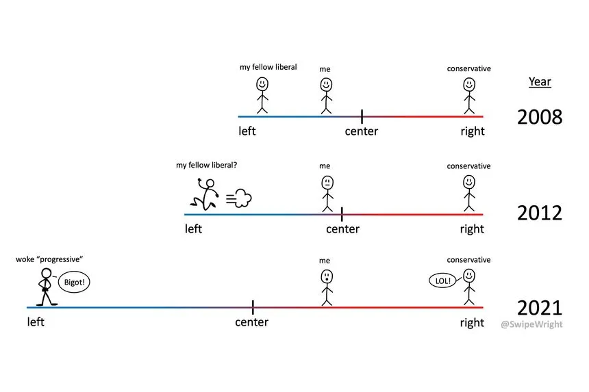
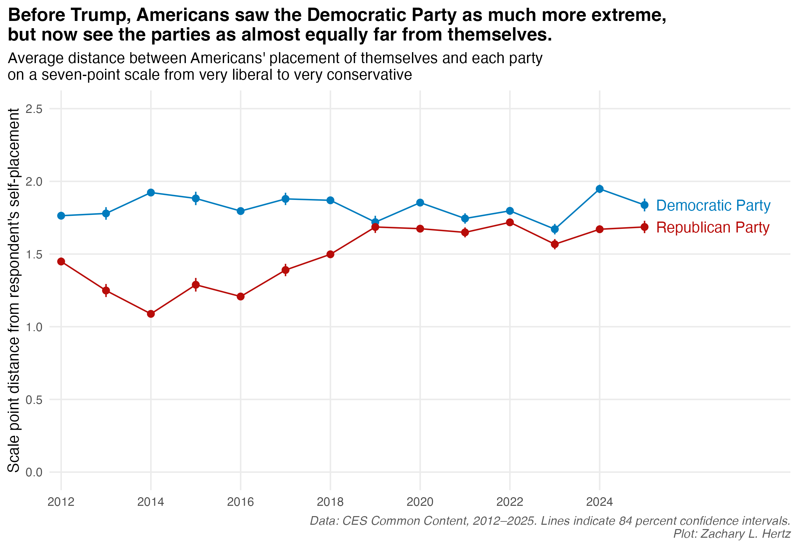
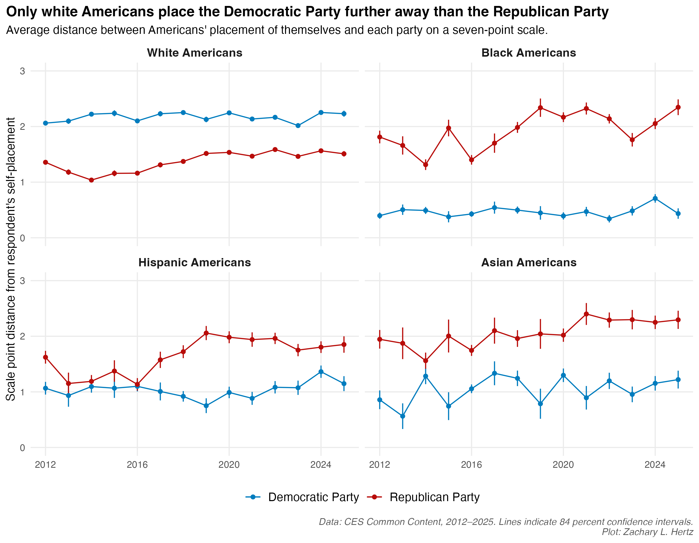

In the wake of the 2024 presidential election, the first Republican popular vote victory since 2004, Democrats set about soul-searching. "Defeating Republicans at the ballot box in 2026 and 2028 is a moral and political imperative," warned a widely cited memo titled "[Deciding to Win](https://decidingtowin.org/)."

The 2025 memo, authored by Simon Bazelon, opens with the argument that while both parties have become more extreme since 2012, voters have noticed a leftward shift among Democrats but not the movement among the Republican Party. This became a common refrain --- in March 2026 commentator Matt Yglesias argued in [The New York Times](https://www.nytimes.com/2026/03/16/opinion/democrats-senate-moderate.html?unlocked_article_code=1.XFA.rqm9.UaaAtPw4wLKI&smid=url-share)[^1] that Democrats' party label "has become so toxic" that Democrats should "try to change their brand."

Democrats' remarkable win over both chambers of Congress in an astonishing wave this month has only sparked new interest in this debate, as both parties look forward to 2028. Since the election, centrist think tank Third Way has [argued](https://www.thirdway.org/memo/moderates-made-democratic-majorities) that moderate candidates built the new majority, while Representative Pramila Jayapal, former chair of the Congressional Progressive Caucus, [conceded](https://rollcall.com/2026/11/04/takeaways-midterm-elections-progressive-moderate-democrats/) that "we still are not particularly popular as a Democratic Party across the country." The argument has purchase from popular figures on the right. When Elon Musk first announced his support for Republicans in the 2022 midterm elections, he [shared a cartoon](https://www.dropbox.com/scl/fi/rl3lnjy1sfhtlz0lpqbcb/Screenshot-2026-03-30-at-1.34.14-PM.png?rlkey=uxm02x8bl2ulnb7kvl2z0sfov&dl=0) depicting the Democratic Party sprinting left since 2012 while the Republican Party stood still. 

{.lightbox group="ideology-gallery" width=75%}

This raises the question: how do voters perceive the parties, and how have these views changed over time? We can answer this question with public academic data. Every year since 2012, the [Cooperative Election Study (CES)](https://dataverse.harvard.edu/dataverse/cces) has asked tens of thousands of Americans to place themselves, the Democratic Party and the Republican Party on a seven-point scale running from "very liberal" to "very conservative."[^2] While these survey questions can't tell us whether the parties actually moved or not,[^3] they do serve as a good measure for how voters perceive the party brands.

The data suggests that while Americans do perceive the Democratic Party far to their ideological left, they have done so every year since 2012 and do not think the party has moved further to their left over time. That perception comes mostly from white Americans; every other racial group places the Democratic Party closer to themselves than the Republican Party. But since Trump's ascendancy in 2016, Americans think the Republican Party has moved much further to their ideological right. Democratic voters, however, place themselves to the left of their party.

# Americans have long seen the Democratic Party as farther to their left than the Republican Party sits to their right

To conduct this analysis, I measure how each person in the survey places themselves and the two parties on a seven-point ideological scale. Respondents are asked to rate themselves, the parties, and a number of political figures on a seven-point scale: 

1. Very Liberal
2. Liberal
3. Somewhat Liberal
4. Middle of the Road
5. Somewhat Conservative
6. Conservative
7. Very Conservative
8. Not sure

We can then evaluate how far the average person places each party from themselves on this scale. In 2024, the average American said that the Democratic Party was about two points to their left and the Republican Party about 1.7 points to their right. Recent polling finds similar patterns; a September 2025 [Washington Post-Ipsos poll](https://www.ipsos.com/en-us/americans-favor-republicans-key-issues-prefer-democrats-control-next-congress) found that 54 percent of Americans think the Democratic Party is too liberal and 49 percent think the Republican Party is too conservative. So, pundits are right that there are more Americans who view the Democratic Party as too liberal than those who view the Republican Party as too conservative. But the suggestion that this is a modern phenomenon is not backed up in the data.

{.lightbox group="ideology-gallery" width=100%}

Looking at rankings going back to 2012, Americans have ranked the Democratic Party as more ideologically distant than the Republican Party in every year,[^4] but also see their distance from the Democratic Party as remarkably stable over time. Americans in 2012 viewed the Democratic Party as more liberal than themselves by about 1.76 points in 2012 and 1.95 points in 2024. But while the average American in 2014 saw the Republican Party as only 1.09 points to their right, the onset of the Trump era reshaped how voters saw the party. In 2016, Americans saw the party as 1.21 points to their right and 1.67 points to their right in 2024. The end result is that while Americans in 2016 did perceive the Democratic Party as more extreme than the Republican Party, that gap has halved in eight years of the Trump era.

# It is mostly white Americans who see the Democratic Party as more liberal

The finding that Americans see the Democratic Party as more liberal than the Republican Party is conservative belies the important point that this is largely a pattern among white Americans. In 2016, white Americans  on average placed the Democratic Party about 81 percent further from themselves than the Republican Party. By 2024, this difference shrunk to a placing the Democratic Party about 44 percent further from themselves than the Republican Party. 

Black Americans, who have long been a key Democratic Party constituency, have consistently placed the Republican Party as further to their right than the Democratic Party sits on their left. By 2024, they were placing the Republican Party nearly three times more ideologically distant from themselves relative to the Democratic Party.

{.lightbox group="ideology-gallery" width=100%}

Hispanic Americans in 2016 rated the Democratic and Republican Parties as about equally distant from them. Over Trump's first term, their ratings of the Democratic Party stayed about the same distance from them as they rated the Republican Party further and further from themselves. In 2020, Hispanic Americans placed the Republican Party about twice as far as the Democratic Party was relative to their self-placements. But over the Biden presidency, Hispanic Americans' placement of the Republican Party drifted slightly closer to their ratings of themselves as their ratings of the Democratic Party drifted further, closing about half the gap.

Asian Americans, meanwhile, saw similar distancing of the Republican Party during the Trump era even as they have consistently placed the Republican Party further from themselves than the Democratic Party in every year since 2012.[^5] Asian Americans placed the Republican Party 1.75 points to their right in 2016 and 2.25 points to their right in 2024. But unlike Hispanic Americans, Asian Americans did not think the Democratic Party had drifted to their left over the course of the Biden presidency. In 2024, Asian Americans placed the Democratic Party about as far from themselves as they did in 2016.

It should not be surprising, given that white Americans are about 70 percent of a voters in a given election, that a story about trends among the average American is driven mostly by white Americans. What is notable is that even after looking at racial subgroups, there is little evidence to suggest voters think the Democratic Party is zooming to their left. 

# The Trump era has changed how Americans see the Republican Party

Modern politics is [incredibly partisan](https://www.nytimes.com/2025/10/02/us/politics/times-siena-poll-political-polarization.html?unlocked_article_code=1.RVE.jq7B.dCiDfZg7Gbb4&smid=url-share). Is it possible that Americans who identify as part of the Democratic Party remain ignorant of its leftward lurch while the rest of America watches in dismay? To test this, I split people into partisans, and everybody else (the people who identify as Independents or as part of the other party). 

{.lightbox group="ideology-gallery" width=100%}

In 2012, Republicans said the Republican Party was about halfway between "somewhat conservative" and "conservative." Republicans' rating of the Republican Party moved slightly towards "somewhat conservative" between 2012 and 2016, before returning to the halfway point by 2020 and staying there through 2024. Everyone else, however, seems to think that the Republican Party has become slightly more conservative since Trump first won the party's nomination for president. In 2016, people who did not identify as part of the Republican Party placed the party about halfway between "somewhat conservative" and "conservative." By 2019, however, people who were not part of the Republican Party were consistently placing the Republican Party as firmly "conservative," and did so through 2025. At the same time, while people who did not identify as Republicans placed themselves halfway between "middle of the road" and "somewhat liberal" on average in 2016, by 2024 the people who did not identify as Republicans were rating themselves as "somewhat liberal" on average. The end result is that the distance between how people who are not Republicans see themselves and the Republican Party has widened from about two points to about three, roughly the distance from "somewhat liberal" to "conservative." 

Similar findings appear in polling. A September [Times/Siena poll](https://gvwire.com/2026/09/15/democrats-gain-edge-as-trump-drags-down-gop-new-poll-finds/) found that half of likely voters said that they thought the Democratic Party was too far left, even as they were more likely to call the Republican Party "extreme". 

# Democratic voters moved left rapidly in the Trump Era

Looking at the left side of the chart, what emerges as perhaps the biggest story is Democrats' lurch left over Trump's first term. The average Democrat in 2016 placed themselves as slightly to the right of "Somewhat liberal." But over the next three years, the average Democrat saw themselves as increasingly liberal, even as their placement of the party at large remained relatively stable. By 2020, the average Democrat identified themselves as more liberal than the party, and these relative placements have stayed stable over time since then. This pattern plays out in similar polling data. [55 percent of Democrats](https://news.gallup.com/poll/655190/u-s-political-parties-historically-polarized-ideologically.aspx) in Gallup polling identified as liberal in 2024, nearly twice as many as in the early 2000s. 

This may not necessarily mean that individual Democrats became more liberal after the 2016 election. Because every year's CES data is comprised of a sample of a different set of adults, we can't track whether individuals gave consistent responses over time. The same data suggests that while 45.8 percent of adults identified as Democrats in 2016, 41.5 percent of adults identified as Democrats in 2024. If the moderate Democrats in 2016 stopped identifying as Democrats over the following few years, we would see the average Democrat appear to become more and more liberal even if no one at all changed their minds!

# Did these perceptions hurt Democrats in 2026? 

The general argument put forth by people calling on the Democratic Party to focus on rebranding is roughly this: how the parties are perceived matters, because voters who think the Democratic Party is further from them than the Republican Party are unlikely to vote for Democrats. One implication from what we've found is that white voters, who view Democrats as more ideologically distant than Republicans, should be less likely to vote for Democrats. And yet, evidence suggests that white voters broke almost evenly for Democrats in 2026. The Edison exit poll finds that white voters split evenly for Democratic and Republican House candidates, 49 to 49 percent, just two years after Kamala Harris lost them 42 to 57.[^6]

At the same time, the Democratic brand does not appear to be particularly different than it has in previous years. Americans in the 2025 CES placed the Democratic Party about as far from themselves as they did in the 2012 CES, and [Times/Siena polling](https://gvwire.com/2026/09/15/democrats-gain-edge-as-trump-drags-down-gop-new-poll-finds/) finds that about half of voters think that the Democratic Party is too far to the left. Why, then, might Democrats have still won big even as voters remain cautious about where they stand? 

First, the party that controls the presidency [historically loses seats in a midterm election](https://www.reuters.com/graphics/USA-ELECTIONS/MIDTERM-SWINGS/xmpjwxbeovr/), so Democratic victories may reflect how voters feel about the president more than how they feel about the Democratic Party. Another possibility is that while Democrats may not have rebranded, their candidates may have been able to escape the party brand or even use it as a foil. Polling suggests this may be the case. Times/Siena polls in five Senate battlegrounds, all states that had voted for Trump in 2024, asked likely voters what they thought about both the respective political parties and also the Senate candidates themselves.[^7] Across these five states, 52 percent of likely voters said that they thought the national Democratic Party was too far to the left. In the same polls, only 35 percent of likely voters said they thought the *Democratic Senate candidate in their state* was too far to the left. While it's true that voters tend to be more favorable to the specific candidates running in their state compared to the party as a whole, when asked a similar question about Republicans 47 percent of likely voters said the Republican Party was too far to the right while 41 percent said the Republican Senate candidate in their state was too far right. 

In other words, Senate battleground voters were more likely to call the Democratic Party too far left than its Senate candidates by about 17 points, but only more likely to call the Republican Party too far right than their Senate candidates by about 6 points. This was true across every demographic subgroup the Times reported crosstabs for, and the Independents and Trump 2024 voters seen as crucial to potentially flipping red state Senate seats were especially likely to view the national party as more left than the specific Senate candidates. 

Looking at the CES data, which only tells us about the national party, can't tell us exactly whether these Democrats came across as more moderate than their party because of how they campaigned. Of course, many Democrats who won this month took visible shots at the national party: Roy Cooper ran ads across North Carolina stating that “he bucked his party to oppose defunding the police” while he was governor, Josh Turek centered tax cut and gun rights bills as “just some of the more than 700 times Josh Turek voted with Republicans to look out for Iowans,” and Mary Peltola pledged to “take on anyone, including Democrats” who doesn’t understand what Alaskans need. What the data suggests, ultimately, is that Democrats won big by getting around a brand voters have had in mind since before the Trump era, rather than by managing to change it.

# Conclusion

Have voters, standing still, watched in fright as a Democratic Party ran further and further to their left? The evidence suggests no. It is true that, as Bazelon and Yglesias argue, the average American thinks that the Democratic Party is further from themselves ideologically than the Republican Party. But this is hardly a recent phenomenon, one that has persisted since 2012 and one that has not worsened over time. Furthermore, evidence suggests that the average effect is largely a reflection of perceptions among white Americans. What has changed, however, is how voters perceive the Republican Party. Americans who do not identify as Republicans have come to see more and more distance between themselves and the GOP since the day Donald Trump descended the golden escalator.

What does this mean for 2028? First, while it's true that branding is not a new problem, it remains one that Democrats must take seriously and especially in a presidential cycle. Senate candidates in 2026 managed to persuade voters that they were distinct from the national party. A presidential nominee has no such wiggle room: to the average voter the presidential nominee *is* the national brand. This means questions of how to improve perceptions of the national party are critical for any Democrat hoping to win the White House. Any Democrat who tries to address this by running to the center, however, will also face a precarious balancing act of pleasing a primary electorate that increasingly places itself to the left of the party.

The data suggests that the biggest change, and one which may have weighty implications for 2028, is that voters who are not part of the Republican Party view it as much more extreme than they did in 2016. This may present a much-needed opportunity for Democrats to cast Republicans as too extreme in their efforts to win over swing voters in a national race. Finally, a growing share of Black and Hispanic Americans are unsure about where the Democratic Party stands at all. This may provide candidates with the slack they need for an entrepreneurial candidate to take new stances and redefine the party.

[^1]: This is a gift link!
[^2]: The CES, formerly the Cooperative Congressional Election Study, interviewed at least 60,000 people in every even-numbered year since 2016, and between about 14,000 and 26,000 in odd-numbered years. All estimates use the survey's weights. The 2008 survey asked this question on a 0 to 100 slider, so I leave it out; the plot of partisans starts in 2012. Everything in this post leaves out people who say they are "Not sure" where to place themselves or a party.
[^3]: This is better done with analysis of party platforms, which Deciding to Win does.
[^4]: Except in 2019, a smaller off-year survey (0.06 points, SE 0.056, p = .26). The 2024 difference of 0.31 points (SE 0.036) is down 0.31 from 2016 (SE 0.045) and unchanged from 2012 (p = .42).
[^5]: This has one exception (2014), when Asian American ratings of the two parties are statistically indistinguishable. The odd jumping in 2014 may be driven in part by the fact that Asian Americans are a smaller share of respondents and have noisier estimates.
[^6]: Exit poll figures for [2026](https://en.wikipedia.org/wiki/2026_United_States_House_of_Representatives_elections) and [2024](https://en.wikipedia.org/wiki/2024_United_States_presidential_election) are Edison's, as reported on Wikipedia. Two points of caution: first, comparing House vote to presidential vote is not apples to apples, and second early exit poll numbers are often revised as results are finalized and certified.
[^7]: Alaska, Iowa, Kansas, Ohio and Texas, fielded Sept. 21 to Oct. 1, 2026; 2,405 likely voters answered these questions. The figures come from the Times/Siena cross-tabs for the pooled battleground sample ([Iowa's are here](https://www.nytimes.com/interactive/2026/10/04/polls/times-siena-iowa-poll-crosstabs.html?unlocked_article_code=1.PVE.RoJk.7C1M7z9yOG5Y&smid=url-share)). In all five states, more voters said the national Democratic Party was too far left than the number of voters who said the same of the state's Senate candidate.
